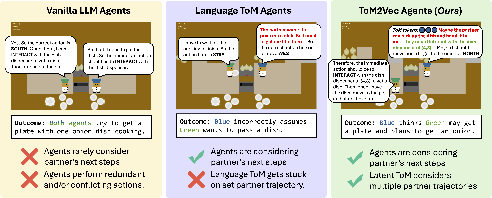

# ToM2Vec: Continuous Theory-of-Mind Tokens for Multi-Agent Coordination

[](https://arxiv.org/abs/ARXIV_ID)
[](https://opensource.org/licenses/MIT)

[Nithin Sivakumaran](https://nsivaku.github.io/) | [Ali Payani](https://www.linkedin.com/in/ali-payani-59267515/) | [Hyunji Lee](https://amy-hyunji.github.io/) | [Mohit Bansal](https://www.cs.unc.edu/~mbansal/) | [Elias Stengel-Eskin](https://esteng.github.io/)


Figure: *Left*: Vanilla LLM agents (using Qwen3-8B) each reason only about their own plan. Both independently conclude they should fetch a dish from the dispenser, producing redundant and conflicting behavior. *Middle*: Language ToM Agents are able to more frequently consider their partner’s next actions, but they often commit to a single line of reasoning without considering other potential paths. *Right*: Our method TOM2VEC is used to train an agent (blue hat) with stronger ToM capabilities; that agent considers what the untrained partner agent (green hat) is doing before making its own decision.

## Overview

This repository contains the implementation of **ToM2Vec**, a method that trains LLM agents to model a partner agent's reasoning using continuous theory-of-mind (ToM) tokens. These latent tokens represent information about the partner's beliefs and intentions and condition the agent's subsequent reasoning and actions.

## Installation

Use **Python 3.10 or newer** and install the dependencies:

```bash
pip install -r requirements.txt
CMAKE_POLICY_VERSION_MINIMUM=3.5 pip install hanabi-learning-environment
```

## 1. Build training data

Generate training data for the selected environment:

```bash
python build_training_data.py {environment} --out {data_path}
```

For two-player games, each state produces one main-agent/partner pair per player, with each player taking the main-agent role once. Rollouts run to completion, and the resulting pool is subsampled to the requested dataset size.

**Decrypto:** Data generation requires hints from the Encoder. Before generating Decrypto data, serve the base model through an OpenAI-compatible endpoint in a separate terminal:

```bash
vllm serve Qwen/Qwen3-8B --port 8001
```

## 2. Train

Train a ToM2Vec model on the generated data:

```bash
python -m tom2vec.train \
    --data {data_path} \
    --out {output_path} \
    --model-id {model_id} \
    --k-latents {num_latents} \
    [OPTIONS]
```

## 3. Evaluate

### Serve the models

Start the trained ToM2Vec model as an OpenAI-compatible endpoint on port `8000`:

```bash
python -m tom2vec.serve --ckpt {checkpoint_path} --port 8000 [OPTIONS]
```

Serve untrained partner models separately:

```bash
vllm serve Qwen/Qwen3-8B --port 8001
```

### Overcooked

Run the evaluation script:

```bash
python scripts/eval_overcooked.py \
    --main-url http://localhost:8000/v1 \
    --partner-url http://localhost:8001/v1 \
    --seeds 30
```

### Multi-party negotiation

Clone [LLM-Deliberation](https://github.com/S-Abdelnabi/LLM-Deliberation) and set the ToM2Vec agent's name in the game's `config.txt`. Then run:

```bash
OPENAI_BASE_URL=http://localhost:8000/v1 \
python main.py --game_dir {game_dir} --output_dir {output_dir}
```

### Decrypto

Clone [decrypto](https://github.com/facebookresearch/decrypto) and add a `LocalModel` entry to the evaluation config, pointing its `urls` field to the ToM2Vec endpoint:

```yaml
urls: ["http://localhost:8000/v1"]
```

Run the selected configuration:

```bash
python run.py --config-name {config}
```

### Hanabi and Collab Escape/Capture

Clone [llm_coordination](https://github.com/eric-ai-lab/llm_coordination) and ensure the ToM2Vec server is running on port `8000`. Run the benchmarking script for the desired setting:

```bash
python src/agentic_evals/{setting}_agent_benchmarking.py tom2vec
```

## Citation

If you use ToM2Vec in your research, please cite our paper. The arXiv identifier and link will be updated when available.

```bibtex
@misc{sivakumaran2026tom2vec,
    title={ToM2Vec: Continuous Theory-of-Mind Tokens for Multi-Agent Coordination},
    author={Nithin Sivakumaran and Ali Payani and Hyunji Lee and Mohit Bansal and Elias Stengel-Eskin},
    year={2026},
    eprint={ARXIV_ID},
    archivePrefix={arXiv},
    primaryClass={cs.AI},
    url={https://arxiv.org/abs/ARXIV_ID}
}
```